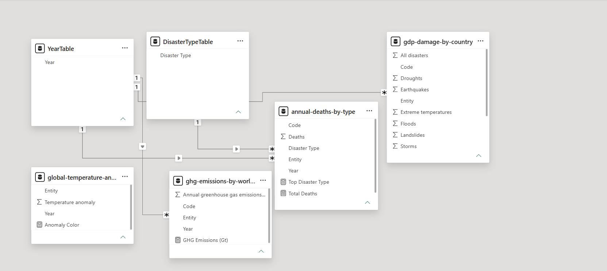
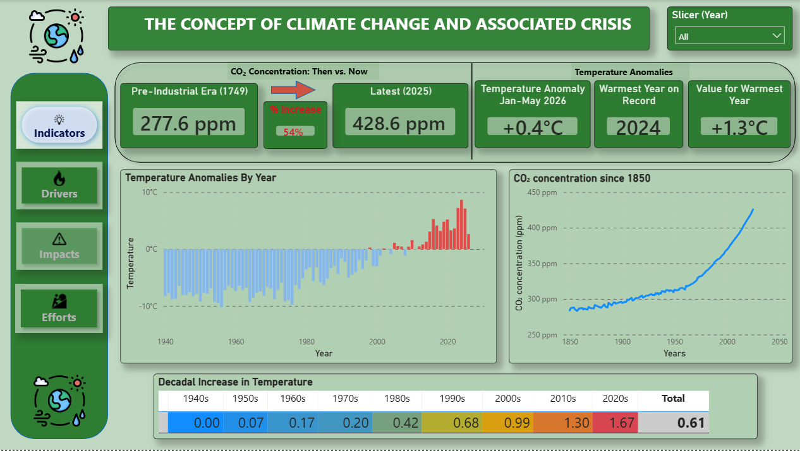
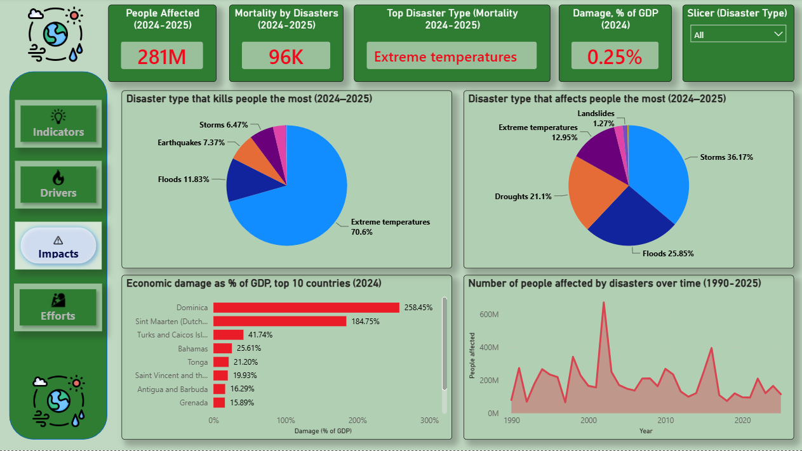
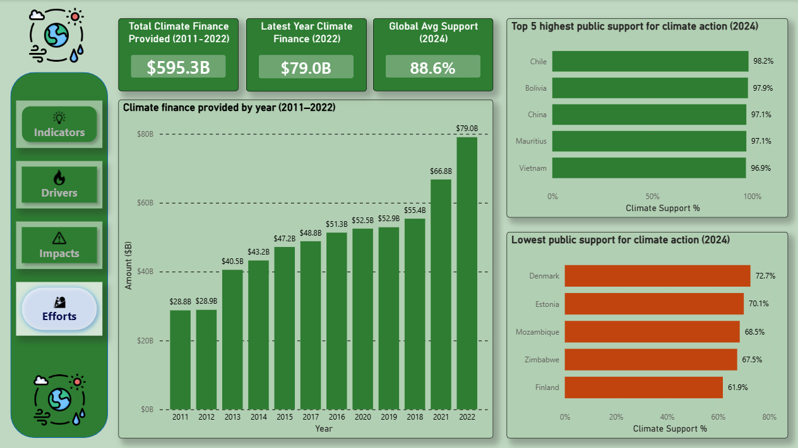

# Climate Change & Global Crisis Intelligence Dashboard (Power BI)

## 📌 Project Overview
This project delivers an end-to-end business intelligence solution exploring the macroeconomic, environmental, and human indicators of the global climate crisis. 

Instead of relying on a single flat file, this system **synthesizes and integrates over 10 independent datasets** sourced from *Our World in Data*. The final product is a highly interactive, 4-page analytical application structured around environmental storytelling: tracking data from initial atmospheric shifts to industrial root causes, humanitarian costs, and global funding initiatives.

---

## 📂 Repository Structure & Data Access
To ensure full reproducibility, all raw source datasets and workspace assets used to compile this dashboard are included directly in this repository:
*   **[/data](/data):** Contains the 10+ raw transactional CSV files extracted from *Our World in Data* covering global greenhouse gas emissions, temperature anomalies, and disaster metrics.
*   **`Climate_Change_Dashboard.pbix`:** The core Power BI production workspace file containing the data model, DAX measures, and interactive reporting canvas.

---

## 🛠️ Tech Stack & Advanced Power BI Features Used
*   **Data Integration & ETL (Power Query):** Cleaned, transformed, and merged 10+ separate transactional CSV datasets with varying geographical and temporal granularities.
*   **Advanced Data Modeling:** Engineered a robust, scalable analytical schema leveraging centralized dimension tables (`YearTable`, `DisasterTypeTable`) to establish proper filtering cardinality across multiple independent fact tables.
*   **DAX (Data Analysis Expressions):** Wrote advanced measures for historical anomalies, multi-decade percentage growth metrics, relative global share distributions, and decadal aggregates.
*   **Advanced UI/UX Design:** Implemented fully responsive page navigation bookmarks, synced multi-page slicers, uniform corporate formatting, and dynamic visual alerts.

---

## 📐 Data Architecture & Modeling
To prevent filtering ambiguity and eliminate performance bottlenecks, the system uses a clean relational design. Shared dimension keys map down directly to individual, independent fact layers.

### Centralized Schema Model

### Schema Components:
*   **Dimension Tables (Master Lookups):** 
    *   `YearTable`: The core temporal anchor filtering metrics chronologically across all fact data.
    *   `DisasterTypeTable`: Standardizes global hazard classification keys across humanitarian tracking sheets.
*   **Fact Tables (Metrics & Ledgers):** 
    *   *Atmospheric Science:* `global-temperature-anomalies`, `global-co2-concentration`, `co2-long-term-concentration`.
    *   *Emissions Engines:* `ghg-emissions-by-world-region`, `contributions-global-temp`, `global-warming-by-gas`.
    *   *Socio-Economic Impacts:* `annual-deaths-from-all-disasters`, `annual-number-of-people-affected`, `annual-economic-damage`, `annual-deaths-by-type`, `annual-affected-by-type`, `gdp-damage-by-country`.
    *   *Global Response:* `green-climate-gcf-funding`, `support-political-climate`, `support-global-avg`.

---

## 🚀 Page-by-Page Analytical Breakdown

### Page 1: Climate Indicators (Atmospheric Baseline)
*   **Focus:** Quantifying physical climate shifts.
*   **Key Insight:** Highlights the leap in CO₂ concentration from the pre-industrial era (**277.6 ppm**) to modern baselines (**428.6 ppm**)—a **54% surge** corresponding directly with a **+1.3°C** value shift during peak anomaly years.
*   **Visual Snapshot:**

### Page 2: Climate Drivers (Root Cause Analysis)
*   **Focus:** Tracking emission output sources by sector, gas type, and national territory.
*   **Key Insight:** Charts historical greenhouse gas generation from 1850 through modern horizons, identifying the **United States (17.7%)** and **China (13.0%)** as the top historical contributors to global warming, alongside a massive shift toward fossil-derived CO₂ and methane.
*   **Visual Snapshot:**

### Page 3: Crisis Impacts (Humanitarian & Economic Cost)
*   **Focus:** Measuring the toll of climate-driven disasters.
*   **Key Insight:** Pinpoints **Extreme Temperatures** as the leading driver of disaster mortality (**70.6%**), while showcasing catastrophic localized macroeconomic stress where economic damages surpass **258% of national GDP** for highly vulnerable nations like Dominica.
*   **Visual Snapshot:**

### Page 4: Mitigation Efforts (Global Finance & Sentiment)
*   **Focus:** Evaluating international response funding alongside public backing variables.
*   **Key Insight:** Visualizes the expansion of global climate finance scaling to **\$79.0B** annually. It reveals a stark disparity in civic sentiment, where nations like Chile express **98.2% public support** for systemic climate action compared to significantly lower thresholds in parts of Europe.
*   **Visual Snapshot:**

---

## 💡 Key Portfolio Takeaways
1. **Heterogeneous Data Aggregation:** Successfully established unified relationship keys across structural datasets measuring completely unrelated attributes (parts-per-million gas metrics vs. national GDP percentages).
2. **Actionable Executive Layout:** Utilized clear visual signaling hierarchy allowing recruiters or stakeholders to step seamlessly through a complex macro-environmental problem in a narrative workflow.
3. **Advanced DAX & Time Intelligence:** Used time-intelligence frameworks to calculate complex sliding decadal means, giving end users smooth trend assessments across two centuries of raw metrics.
